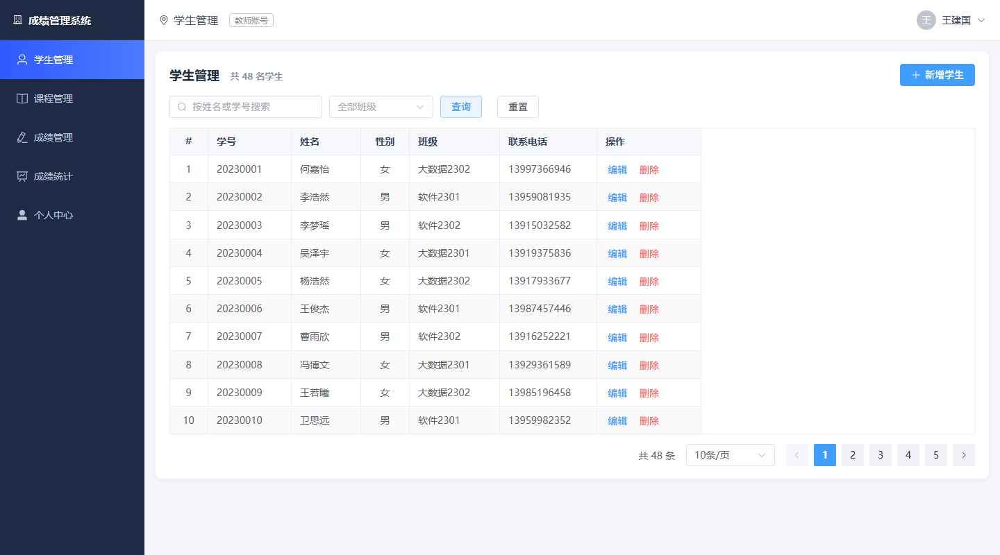
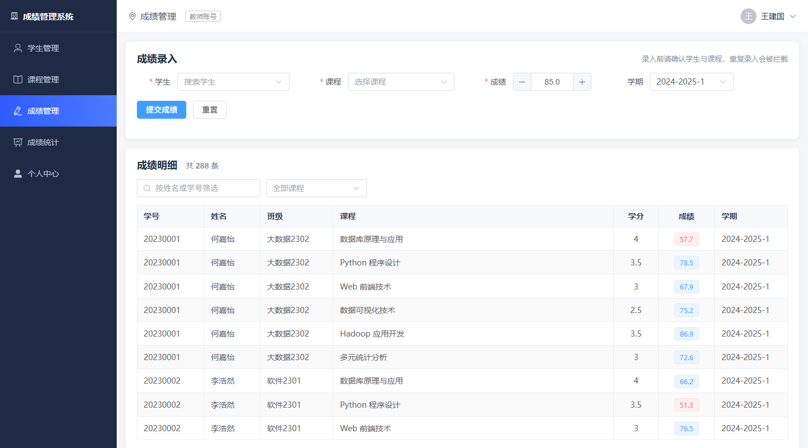

# 学生成绩管理系统 · Flask 后端 + Vue 前端

<p>
  
  
  
  
  
  
  
</p>

**Vue 3 + Element Plus 前端（6 个页面 + 角色权限）** ｜ **Flask + JWT 后端（48 名学生 / 6 门课程 / 288 条成绩）**

> 同一套业务的 Java 版实现在 [grade-springboot](https://github.com/jc67486/grade-springboot)（Spring Boot + MyBatis-Plus + EasyExcel），两版业务一致、技术栈不同，可对照阅读。

前后端分离的教务管理系统：教师与学生两种角色，覆盖学生、课程、成绩的增删改查与统计，
含路由级权限、按钮级权限、通用表格组件与前后端双重校验。



<p align="center">
  <sub>学生管理 · 表格 + 关键字/班级筛选 + 分页，共 48 名学生（教师角色可见新增/删除）</sub>
</p>



<p align="center">
  <sub>成绩录入与明细 · 必填校验 + 0–100 范围 + 按分数段着色（不及格红 / 及格蓝 / 优秀绿）</sub>
</p>

## 功能模块

| 模块 | 说明 |
|---|---|
| 权限 | `vue-router` 守卫 + `meta.roles` 过滤菜单 + 按钮级权限；后端区分 401（未登录/过期）与 403（角色越权） |
| 状态 | Pinia 管 token / 用户 / 角色，`localStorage` 持久化，登出重置路由 |
| 请求层 | Axios 双拦截器注入 Bearer token、映射错误码；401 加重定向锁，避免并发重复弹窗 |
| 通用表格 | 列配置 + 分页 + 搜索 + loading + 空状态 + 操作列插槽，3 个页面复用 |
| 表单校验 | 前后端双重：必填 / 0–100 范围 / 8 位学号 / 手机号正则；后端再校验重复成绩与存在性 |
| 构建 | Element Plus 按需引入，产物 1.6 MB → 762 KB |
| 测试 | pytest 29 个用例，覆盖率 94% |
| 数据分析 | 6 条窗口函数（`RANK` / `AVG OVER` / `LAG` / `NTILE` / `ROW_NUMBER` / `SUM OVER`） |

## 技术栈

| 层 | 技术 |
|---|---|
| 前端 | Vue 3（组合式 API）、Vite 5、vue-router 4、Pinia 2、Element Plus 2.8（按需引入）、Axios |
| 后端 | Flask 3、PyJWT（HS256，2 小时过期）、SQLite |
| 测试 | pytest + pytest-cov |

## 快速开始

```bash
# 1. 后端
cd server
pip install -r requirements.txt
python seed.py          # 生成 grades.db（48 学生 / 6 课程 / 288 成绩）
python app.py           # http://127.0.0.1:5002

# 2. 前端（另开一个终端）
cd ..
npm install
npm run dev             # http://127.0.0.1:5174
```

演示账号：

| 用户名 | 密码 | 角色 | 能做什么 |
|---|---|---|---|
| `teacher` | `123456` | 教师 | 全部页面，可增删改学生、录入成绩 |
| `student` | `123456` | 学生 | 看不到学生管理；录入接口返回 403 |

## 接口

| 方法 | 路径 | 权限 | 说明 |
|---|---|---|---|
| POST | `/api/login` | 公开 | 登录签发 JWT（2 小时） |
| GET | `/api/me` | 登录 | 当前用户 |
| GET | `/api/students?page&size&keyword&class` | 登录 | 分页查询（含搜索） |
| POST/PUT/DELETE | `/api/students[/:id]` | **教师** | 增删改，越权返回 403 |
| GET | `/api/courses` | 登录 | 课程列表 |
| GET | `/api/grades?keyword&course_id` | 登录 | 成绩明细 |
| POST | `/api/grades` | **教师** | 录入，重复/越界返回 400 |
| GET | `/api/stats` | 登录 | 各课均分 + 分数段 + 班级均分 |

## 权限设计：为什么 401 和 403 要分开

```
401 Unauthorized  → 没登录 / token 过期  → 前端清 store 并跳登录页（保留 redirect）
403 Forbidden     → 已登录但角色不够     → 前端只提示"无权限"，不动登录态
```

如果把越权也返回 401，学生会莫名其妙被踢出登录，且分不清是「会话过期」还是「权限不足」——前端也就无法决定是跳登录页还是只弹提示。

**并发 401 的处理**：5 个请求同时收到 401 时，用一个 `redirecting` 锁保证只跳转一次、只弹一次提示，其余请求直接 reject，不再触发跳转。

## 测试

```bash
cd server
python -m pytest tests -q --cov=app --cov-report=term-missing
# 29 passed，app.py 覆盖率 94%
```

每个用例用**独立的数据库副本**（`tmp_path` + `shutil.copy`），不污染开发数据：

```python
@pytest.fixture()
def client(tmp_path):
    tmp_db = tmp_path / "grades.db"
    shutil.copy(SRC_DB, tmp_db)
    app_module.DB = str(tmp_db)
```

覆盖点：登录成功/失败/缺字段、无 token 401、伪造 token 401、教师 vs 学生 403、分页越界、
关键字与班级筛选、学号唯一约束、成绩重复拦截、0–100 越界、非数字分数、**删除学生级联清理成绩**、统计口径。

> 测试中抓到两个真问题：`datetime.utcnow()` 已废弃、JWT 密钥 23 字节低于 HS256 建议的 32 字节，均已修复。

## 数据分析

```bash
python run_analytics.py     # 逐条执行 sql/analytics.sql 并打印结果
```

| # | 函数 | 业务问题 |
|---|---|---|
| ① | `RANK() OVER` | 班级平均分排名 |
| ② | `AVG() OVER (PARTITION BY)` | 学生总分与班级均分的差额（窗口聚合不折叠明细行） |
| ③ | `LAG() OVER` | 同一学生各科环比，看偏科 |
| ④ | `NTILE(4) OVER` | 每门课按成绩分四档，定位挂科风险 |
| ⑤ | `ROW_NUMBER()` + 外层过滤 | 每门课第一名（窗口函数不能写在 `WHERE`） |
| ⑥ | `SUM() OVER ()` | 各分数段人数占比 |

## 性能数据

| 指标 | 数值 | 测量方式 |
|---|---|---|
| 构建产物 | 1.63 MB → 762 KB（按需引入前后对比） | `dist` 目录递归汇总 |
| JS / CSS | 1274 → 612 KB / 487 → 149 KB | 同上 |
| 页面 chunk | 6 个页面各自独立，最大 5.7 KB | `npm run build` 输出 |
| 测试覆盖率 | 94%（app.py 183 行，覆盖 172 行） | `pytest --cov=app` |

## 踩坑记录

1. **按需引入后 `el-tag` 整列空白**：`<el-tag>` 写在 `el-table-column` 的具名插槽里，`unplugin-vue-components` 没解析到，运行时 `resolveComponent` 落空后静默不渲染。解法是显式 `import { ElTag } from 'element-plus'`。
2. **图标全部消失**：去掉全量注册后，菜单里的 `<component :is="m.icon" />` 传的是字符串，无法解析。改成图标映射对象 `ICONS[m.icon]`。
3. **函数式组件没样式**：`ElMessage` / `ElMessageBox` 是手动 import 的，`unplugin` 不会自动注入样式，需补 `element-plus/es/components/message/style/css`。
4. **学生被越权踢下线**：早期所有失败都返回 401，导致学生访问教师接口时被清掉登录态。改为 403 后语义才对。
5. **重复提交产生脏数据**：前端按钮加 loading 锁只是体验层，后端必须再校验一次「同一学生 + 同一课程不可重复录入」，否则绕过前端就能造重复成绩。

## 目录结构

```
grade-admin/
├── server/
│   ├── seed.py              # 建库 + 生成 48 学生 / 6 课程 / 288 成绩
│   ├── app.py               # Flask + JWT（蓝图、统一响应、401/403）
│   ├── run_analytics.py     # 6 条窗口函数分析
│   ├── sql/analytics.sql    # SQL 集（排名 / 环比 / 分位 / 占比）
│   ├── tests/               # pytest（29 个用例，覆盖率 94%）
│   └── README_TESTS.md      # 测试与覆盖率说明
├── src/
│   ├── api/request.js       # Axios 双拦截器 + 401 重定向锁
│   ├── router/index.js      # 路由表 + 守卫 + buildMenus 动态菜单
│   ├── store/user.js        # Pinia + localStorage 持久化
│   ├── layout/Layout.vue    # 侧边菜单 + 头部
│   └── views/               # Login / Students / Courses / Grades / Stats / Profile / NotFound
└── shot/                    # 界面截图
```

## 已知限制

- 密码用 MD5 存储（演示用），生产应换 bcrypt + 盐 + 登录限流
- 成绩查询未做服务端分页，数据量大时需补 `page/size` 与索引
- Element Plus 图标仍为按需导入，CSS 可进一步用 `unplugin` 的 `importStyle` 拆分
